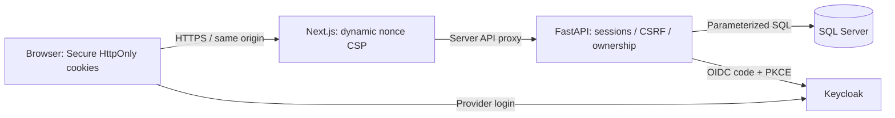

# Architecture

Finance amounts are PHP integer centavos. SQL computes balances and summaries. Authlib verifies provider tokens; browser cookies contain opaque random session identifiers. Session hashes, CSRF secrets, users, finance and audit events live in SQL Server. CSV stays in bounded request memory; confirmation inserts batch, transactions and audit in one transaction.

Trust boundaries: browser input is untrusted; provider claims require validation; server owns user scope; runtime database permissions must exclude schema changes. No hosted model, workers or external finance data connection exists. Next security policies apply to document responses; API responses have separate privacy headers. Next rendering is dynamic so script nonces are request-specific.
